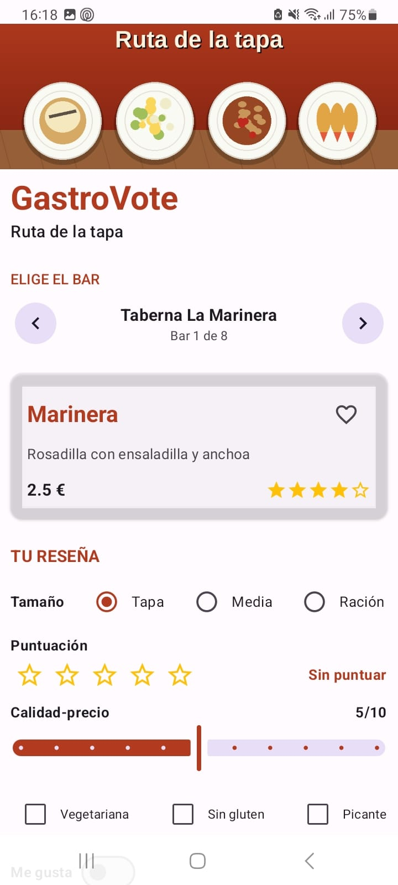
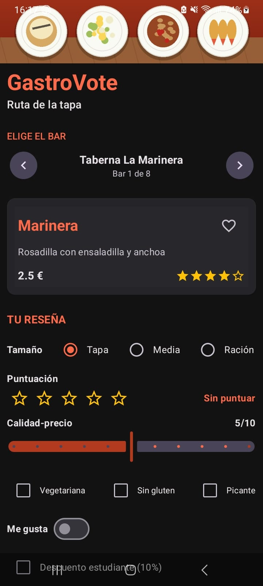
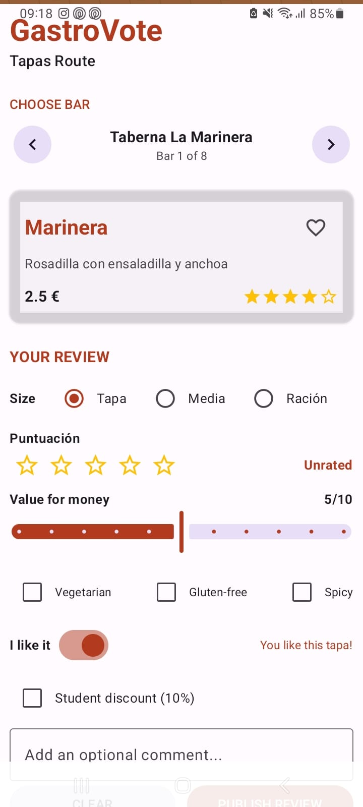

# GastroVote - Documentación y Pruebas

## Pruebas 

A continuación se recogen los resultados de la comprobación de la aplicación bajo diferentes escenarios y condiciones de ejecución:

| ID | Condición / Caso de Prueba | Resultado Esperado | Estado |
| :--- | :--- | :--- | :--- |
| **P1** | **Dispositivos de distinto tamaño (Vertical):** Probar en un *Small Phone* y una *Medium Tablet*. | El contenido no se adapta correctamente | **MAL** |
| **P2** | **Tema claro y tema oscuro:** Alternar el tema del sistema. | La interfaz conmuta de forma fluida; los fondos de tarjetas usan superficies adaptativas (`surfaceVariant`) y los textos se leen perfectamente. | **OK** |
| **P3** | **Idiomas (Español e Inglés):** Cambiar el idioma del sistema a inglés. | Todos los textos estáticos, botones y mensajes flotantes (Toasts) cambian dinámicamente gracias a los recursos `strings.xml`. | **OK** |
| **P4** | **Tamaño de fuente del sistema al máximo:** Subir la accesibilidad de texto al límite superior. | Los textos escalan correctamente y el scroll evita solapamientos o desbordamientos en pantalla. | **OK** |
| **P5** | **Navegación circular de bares:** Usar ◀ y ▶ pasando del último al primero y viceversa. | El índice y el nombre del bar rotan de forma controlada sin provocar excepciones de límites. | **OK** |
| **P6** | **Publicar sin estrellas:** Pulsar publicar con la puntuación a 0. | Salta el Toast de aviso impidiendo guardar una reseña vacía. | **OK** |
| **P7** | **Cálculo de precios y descuentos:** Comprobar el precio con cada tamaño, con y sin descuento. | El precio total se recalcula dinámicamente en tiempo real. | **OK** |
| **P8** | **Reseñar dos veces el mismo bar:** Enviar una reseña, modificarla y volver a publicarla. | El sistema detecta el estado previo, actualiza el registro existente y muestra el mensaje correspondiente. | **OK** |
| **P9** | **Cancelar diálogo de Limpiar:** Pulsar limpiar y cancelar en el AlertDialog. | El diálogo se cierra de forma limpia y los datos introducidos en el formulario se mantienen intactos. | **OK** |

---

## Entrega

A continuación se muestran las capturas de pantalla de la aplicación cumpliendo con los requisitos visuales en vertical, modo oscuro e inglés:

### Captura en Modo Vertical

### Captura en Modo Oscuro

### Captura en Inglés

